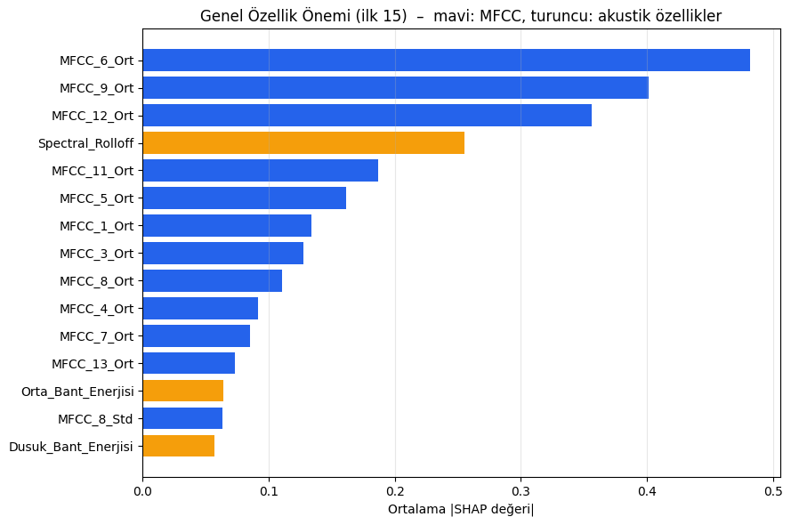
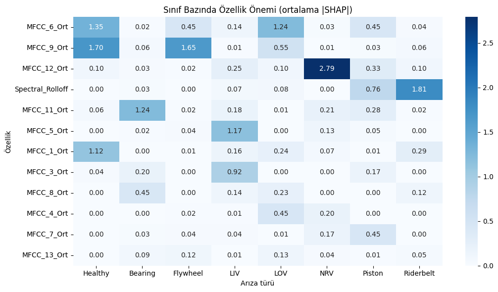
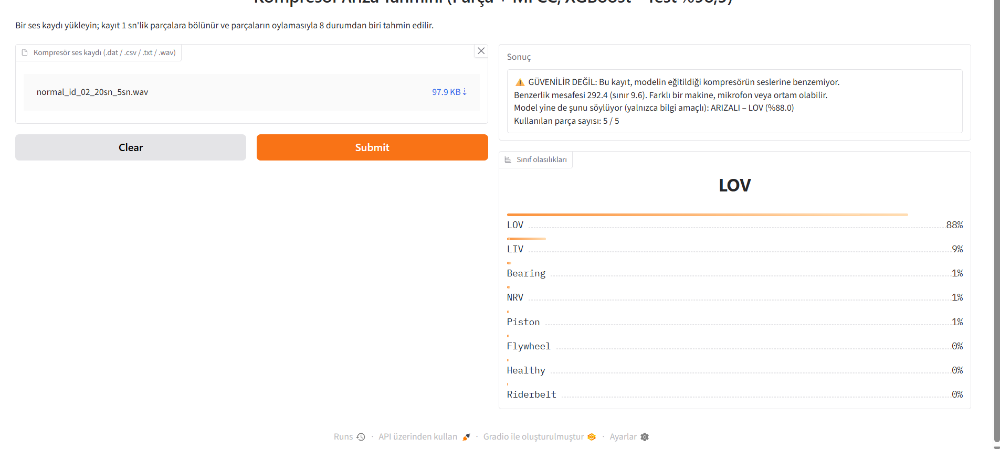

# Akustik Sinyallerle Hava Kompresörü Arıza Teşhisi

Bir hava kompresörünün çalışırken çıkardığı sesten, kompresörün **sağlıklı** mı yoksa **7 arıza türünden** birinde mi olduğunu tahmin eden makine öğrenmesi projesi.

> **English summary.** Acoustic fault diagnosis for a reciprocating air compressor (8 classes: healthy + 7 faults). Recordings are split into 1-second segments; 14 acoustic features + 26 MFCC features feed an XGBoost classifier, and segment probabilities are averaged per recording. Test accuracy: **98.53 %** (up from 90.44 % with whole-recording features). A Mahalanobis-distance confidence check flags recordings that do not resemble the training compressor, and SHAP shows which features drove each decision. Cross-machine tests show the model is machine-specific; see *Limitations*.

## Sonuçlar

| Model | Validation Acc. | Test Acc. | Eğitim–validation farkı |
|---|---|---|---|
| Tüm kayıt, 14 özellik | %85,66 | %90,44 | 9,64 puan |
| Parça + 14 özellik | %87,13 | – | 3,47 puan |
| **Parça + 14 özellik + MFCC (nihai)** | **%99,26** | **%98,53** | **0,66 puan** |

- Test kümesinde 272 kaydın 268'i doğru sınıflandırıldı. **Healthy sınıfında hiç hata yok**: sağlıklı kompresör arızalı sayılmadı, hiçbir arıza gözden kaçmadı.
- Kalan 4 hata Piston (3) ve Riderbelt (1) kayıtlarında.
- Veri, aynı kayıt numarasının farklı kümelere düşmemesi için **Reading numarasına göre gruplu** bölündü (%70 / %15 / %15).

### Açıklanabilirlik (SHAP)

Toplam önemin **%83,7'si** MFCC özelliklerinden geliyor. Her arıza türünün kendine özgü bir "imzası" var; örneğin NRV'yi MFCC_12, Riderbelt'i Spectral_Rolloff belirliyor.

<p align="center">
  
  
</p>

### Güven kontrolü

Model "bilmiyorum" diyemediği için başka bir kompresörün **sağlam** sesini %88 güvenle "LOV arızası" olarak sınıflandırdı. Bunu önlemek için eğitim verisine Mahalanobis mesafesiyle bir güven kontrolü eklendi (eşik 9,56):

| Kayıt | Mesafe | Sonuç |
|---|---|---|
| Kendi kompresörü, test kayıtları (ortalama) | 5,9 | ✅ %99,3'ü tanıdık |
| Başka kompresör, sağlam (Zenodo) | 292,4 | ⚠️ Güvenilir değil |
| Başka kompresör, arızalı (Zenodo) | 29 551,6 | ⚠️ Güvenilir değil |

<p align="center"></p>

## Depo yapısı

```
├── app/app.py          Gradio arayüzü (kayıtlı modeli yükler, eğitim gerektirmez)
├── model/              XGBoost modeli, özellik sırası, güven kontrolü parametreleri
├── notebooks/          Colab defteri: veri hazırlamadan SHAP'a kadar tüm adımlar
├── ornekler/           Arayüzde denemek için iki kısa kayıt (Zenodo, CC BY 4.0)
├── docs/               Şekiller
└── requirements.txt
```

## Çalıştırma

**Arayüz (bilgisayarda):**

```bash
pip install -r requirements.txt
python app/app.py
```

Tarayıcıda açılan sayfaya bir `.dat` veya `.wav` kaydı yükleyin. Sonuç; tahmin edilen durum, sınıf olasılıkları, güven kontrolü ve kararı en çok etkileyen özellikleri gösterir.

**Modeli yeniden eğitmek:** `notebooks/Kompresor_Ariza_Teshisi.ipynb` defterini Google Colab'da açın. Veri setini indirip `AirCompressor_Data.zip` adıyla Drive'da `Colab Notebooks/` klasörüne koyun ve hücreleri sırayla çalıştırın.

## Yöntem

1. **Özellikler:** Her 50 000 örneklik kayıt 10 000 örneklik 5 parçaya bölünür. Her parça için 14 akustik özellik (RMS, kurtosis, crest factor, spektral merkez, bant enerjileri, spectral rolloff vb.) ve 13 MFCC katsayısının ortalaması ve standart sapması hesaplanır (toplam 40).
2. **Model:** XGBoost (`n_estimators=100`, `max_depth=3`, `learning_rate=0.05`). Bir kaydın sınıfı, 5 parçanın olasılıklarının ortalamasıdır.
3. **Güven kontrolü:** Eğitim parçalarının standartlaştırılmış özelliklerine Ledoit–Wolf kovaryansı ile Mahalanobis mesafesi; eşik, validation kayıtlarının 99. yüzdeliği.
4. **Açıklanabilirlik:** XGBoost'un yerleşik TreeSHAP hesabı.

## Sınırlılıklar

- Model **tek bir kompresörde** eğitilmiştir ve **makineye özgüdür**. Başka bir makinede kullanmak için o makinenin etiketli kayıtlarıyla yeniden eğitilmesi gerekir. Güven kontrolü bu durumu fark eder ama arıza teşhisini düzeltemez.
- Başka bir kompresörün farklı günlerde alınmış sağlam kayıtlarıyla yapılan anomali tespiti denemelerinde, aynı makinenin sağlam oturumları birbirinden arızalı kayıtlar kadar farklı çıkmıştır. MFCC laboratuvarda en güçlü, farklı koşullarda ise en kırılgan özellik olmuştur.
- Ön işlenmiş kayıtların örnekleme hızı belgelerde açık değildir; MFCC için 10 kHz (50 000 örnek = 5 sn) varsayılmıştır.

## Veri ve kaynaklar

Veri setleri bu depoya dahil değildir.

- **Eğitim verisi:** N. K. Verma vd., "Intelligent Condition Based Monitoring using Acoustic Signals for Air Compressors", *IEEE Transactions on Reliability*, 65(1), 291–309, 2016. Veri: [IIT Kanpur](https://iitk.ac.in/idea/datasets/index.html).
- **Başka kompresör kayıtları (`ornekler/`):** Shaikh, Jawarkar, Ahmed, "Sound database of Industrial Machine for Audio Anomaly Detection", Zenodo, 2024, [doi:10.5281/zenodo.12685116](https://zenodo.org/records/12685116), CC BY 4.0. Örnek klipler bu kayıtlardan 5 saniyelik kesilip 10 kHz'e dönüştürülmüştür.
- S. M. Lundberg, S.-I. Lee, "A Unified Approach to Interpreting Model Predictions", *NeurIPS*, 2017.
- O. Ledoit, M. Wolf, "A well-conditioned estimator for large-dimensional covariance matrices", *Journal of Multivariate Analysis*, 88(2), 2004.
- B. McFee vd., "librosa: Audio and Music Signal Analysis in Python", *Proc. of the 14th Python in Science Conference*, 2015.

## Not

Kodun yazımında, deneylerin tasarımında ve raporun hazırlanmasında yapay zekâ asistanı (Claude, Anthropic) desteği alınmıştır.

## Lisans

Kod MIT lisansı ile paylaşılmıştır (bkz. `LICENSE`). Veri setleri kendi lisanslarına tabidir.
